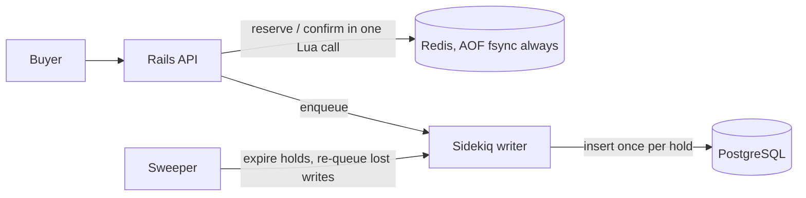
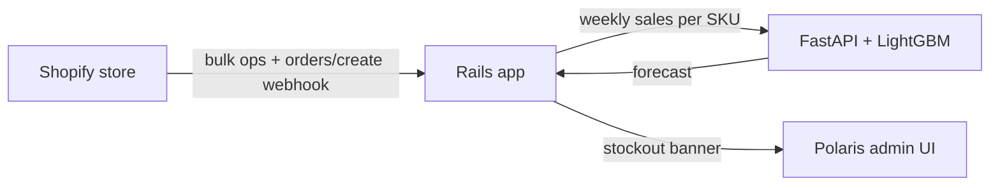
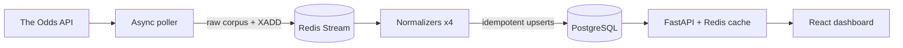

<h1 align="center">
  
</h1>

  <b>I build systems that stay correct under load, recover after crashes, and ship with numbers anyone can reproduce.</b>

  
  
  

---

### 👋 About me

- 🎓 **Computer Science @ University of Waterloo** (class of 2028)
- 💼 **Now: Software Developer Intern @ D2L.** Shipping LLM features to production
- 🧭 **Before: Full-stack @ The Traveller.** Generative-AI engine 
- 🎯 **Looking for:** Summer 2027 SWE internships in backend, infrastructure, or commerce
- 🏋️ **Off the keyboard:** powerlifting

---

### 🚀 Featured projects

#### ⚡ [Flashpoint](https://github.com/CharlieNotChilly/Flash-Point): a checkout engine that never oversells
`Ruby on Rails` `Redis Lua` `Sidekiq` `PostgreSQL` `k6` `Docker` `GitHub Actions`

- **Correctness:** 5,000 simultaneous buyers on 1,000 units → **exactly 1,000 orders, 0 oversold**, verified by an end-to-end stock invariant
- **Atomicity:** stock check, deduction, and hold creation happen in one Redis Lua call; 20 duplicate retries with the same idempotency key decrement stock once
- **Recovery:** confirmations stay in a Redis pending set until PostgreSQL commits; a reconciler re-queues lost jobs, and repeated delivery still produces **exactly one order**

<b>How it works</b>

#### 📦 [Shelfwise](https://github.com/CharlieNotChilly/Shelfwise): AI inventory forecasting for Shopify merchants
`Ruby on Rails` `Shopify GraphQL API` `Polaris` `Python` `LightGBM` `FastAPI`

- **Accuracy:** cut forecast error (WAPE) from **73.6% to 63.4%** vs. a moving-average baseline across 500 SKUs × 52 weeks, with rolling-origin refits and no future-data leakage
- **Product:** embedded Shopify app‡ that warns merchants before a SKU runs out, demoed on a dev store with **1,000‡** real orders
- **Integration:** syncs orders through GraphQL bulk operations and webhooks‡ with a cost-aware client that stays within Shopify's rate limits

<b>How it works</b>

#### 📈 [LineValue](https://github.com/CharlieNotChilly/Line-Value): real-time odds analytics & risk platform
`Python` `FastAPI` `asyncio` `Redis Streams` `PostgreSQL` `React` `Docker`

- **Ingestion:** at-least-once Redis Streams consumers with idempotent upserts normalize odds from **28‡ sportsbooks**: **4,800‡ quotes/s** in replay at **45 ms‡** p95
- **Serving:** de-vigged, leave-one-out pricing engine behind Redis-cached FastAPI at **38 ms‡** p99 under 200 concurrent clients
- **Evaluation:** with a frozen threshold, flagged prices beat the closing consensus **58%‡** of the time vs. **49%‡** for matched controls across **1,100‡** events

<b>How it works</b>

---

### 🛠️ Tech I use

**Languages & frameworks** 

**Backend, data & cloud** 

**DevOps & tools** 

---

### 📊 Activity

  

<picture>
  <source media="(prefers-color-scheme: dark)" srcset="https://raw.githubusercontent.com/CharlieNotChilly/CharlieNotChilly/output/github-contribution-grid-snake-dark.svg" />
  
</picture>
